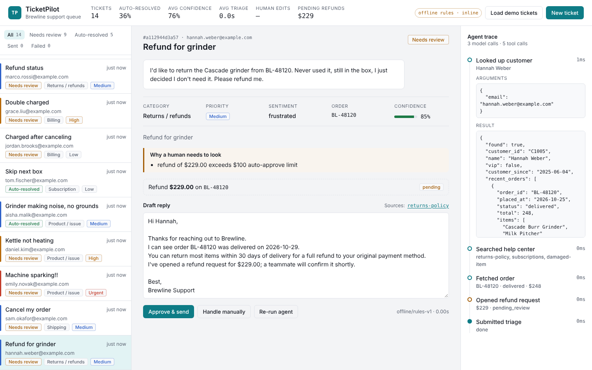
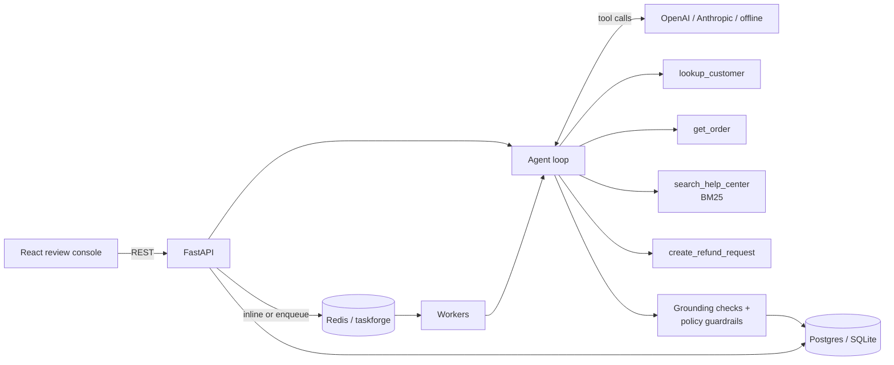
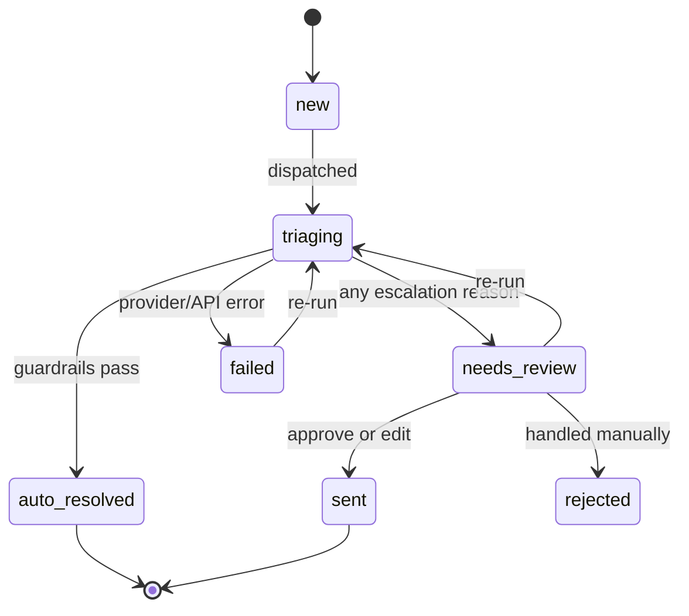

# TicketPilot

[](https://github.com/Dheerajpavuluri/ticketpilot/actions/workflows/ci.yml)


**Live demo:** [ticketpilot-03bi.onrender.com](https://ticketpilot-03bi.onrender.com). Click **Load demo tickets** to watch the agent work the queue.
*The demo runs keyless on the built-in rules engine; add an OpenAI or Anthropic key to use a real model. Free hosting sleeps when idle, so the first load can take up to a minute.*

An AI support agent that works a real ticket queue. For every incoming ticket it looks up the
customer and their orders, searches the help center, opens refunds when policy allows, and
drafts a reply that cites its sources. A set of deterministic guardrails decides whether that
reply goes out automatically or lands in a human review queue, and an eval suite measures
how well it does all of this.

It's built around a sample store, **Brewline** (espresso machines, grinders, coffee
subscriptions), with customers, orders and 12 help-center articles. Point it at a real
order system and knowledge base by swapping out the tools.



## What it does

- **Tool-using agent loop**: the model calls `lookup_customer`, `get_order`,
  `search_help_center` and `create_refund_request`, then finishes with a structured
  `submit_triage` (category, priority, sentiment, order, reply, citations, confidence)
- **Provider-agnostic**: works with OpenAI or Anthropic through thin HTTP adapters. With no
  API key it runs an offline rules engine that speaks the same tool protocol
- **Grounded replies**: a reply can only cite articles the agent actually retrieved and only
  reference orders it actually fetched. Anything else is stripped and the ticket is escalated
- **Guardrails outside the model**: safety hazards, legal threats, chargebacks, account
  deletion, refunds over $100 and low confidence always go to a human, whatever the model says
- **Human-in-the-loop review**: approve, edit-and-send or take a ticket off the AI queue.
  Edits are tracked, so the human edit rate is a quality metric
- **Full agent trace** for every ticket: each model call and tool call, with arguments, results,
  timing and token counts
- **Evals**: 36 labeled tickets scored on classification, escalation precision/recall,
  "unsafe auto-replies", order extraction, citation accuracy and grounding. CI fails if a
  change lets an unsafe reply through
- **Scales out with a queue**: in `queue` mode tickets are processed by
  [taskforge](https://github.com/Dheerajpavuluri/taskforge) workers (my Redis task queue),
  so slow LLM calls never block the API and failed runs retry with backoff

## Architecture



### Ticket lifecycle



## How a ticket is handled

Take *"I'd like to return the Cascade grinder from BL-48120. Never used it, please refund me."*

1. **Model turn 1**: calls `lookup_customer` and `search_help_center("return grinder refund")`
   and `get_order("BL-48120")` in parallel.
2. **Tools** return the customer profile, the returns policy passage (30 days, unused, refunds
   over $100 are reviewed), and the order (delivered Oct 29, grinder $229).
3. **Model turn 2**: policy allows it, so it calls `create_refund_request(BL-48120, 229)`.
4. **Model turn 3**: `submit_triage` with category `returns_refunds`, a reply citing
   `returns-policy`, confidence 0.85.
5. **Grounding check**: citation was retrieved ✓, order was fetched ✓.
6. **Policy**: refund of $229 exceeds the $100 auto-approve limit, so the ticket goes to
   **needs review** with that reason shown. The reviewer approves (or edits) and the refund
   flips to approved.

Order lookups are scoped to the ticket's sender, so a customer can't get the agent to read
someone else's order by quoting its number.

## Guardrails

The model's `needs_human` is advisory. After it finishes, `policy.py` applies rules that can
only make the outcome more cautious:

| Rule | Effect |
|---|---|
| Safety words (sparks, smoke, burn, shock…) | human review, priority forced to **urgent** |
| Lawyer / chargeback / dispute | human review, priority at least **high** |
| Account or data deletion | human review (identity verification) |
| Refund or duplicate-charge claim over `REFUND_REVIEW_LIMIT` | human review |
| Confidence below `AUTO_SEND_CONFIDENCE` | human review |
| Cited an article it never retrieved / referenced an order it never fetched | citation stripped, human review |

## Evals

```bash
cd backend
python -m evals.run_evals --provider offline
ANTHROPIC_API_KEY=... python -m evals.run_evals --provider anthropic --concurrency 4
OPENAI_API_KEY=...    python -m evals.run_evals --provider openai --concurrency 4
```

Each run writes a Markdown and JSON report to `evals/results/` with per-ticket misses.
The metric I care most about is **unsafe auto-replies**: tickets a human should have seen
that the system sent on its own. CI runs the offline eval on every push and fails if that
number is above zero or if any grounding violation appears.

Baseline from the offline rules engine (no LLM), 36 tickets:

| Metric | Offline baseline |
|---|---|
| Category accuracy | 88.9% |
| Priority accuracy (exact / within one level) | 80.6% / 100% |
| Escalation recall | 100% |
| Escalation precision | 43.8% |
| Unsafe auto-replies | 0 |
| Order ID accuracy | 95.8% |
| Citation hit rate | 74.3% |
| Grounding violations | 0 |
| Auto-resolve rate | 55.6% |

The rules engine is deliberately cautious: it never lets a risky ticket through, but it sends
too many safe ones to humans (low precision) and its keyword classifier misreads tickets like
"Charged after canceling" (subscription, not billing). That's the gap an LLM is supposed to
close, and the eval suite is how you check whether a given model and prompt actually does.

## Running it

### Local (no API key needed)

```bash
# backend
cd backend
python -m venv .venv && source .venv/bin/activate
pip install -e ".[dev]"
uvicorn app.main:app --reload            # http://localhost:8000/docs

# frontend (separate terminal)
cd frontend
npm install
npm run dev                              # http://localhost:5173
```

Click **Load demo tickets** to push 12 sample tickets through the agent. To use a real model,
set `ANTHROPIC_API_KEY` or `OPENAI_API_KEY` before starting the backend.

### Docker Compose (Postgres + Redis + API + 2 workers)

```bash
cp .env.example .env    # optionally add an API key
docker compose up --build
```

The API serves the built React app at http://localhost:8000.

## API

| Method | Path | |
|---|---|---|
| `POST` | `/api/tickets` | Create a ticket; triage starts in the background (`202`) |
| `GET` | `/api/tickets?status=` | Queue, optionally filtered by status |
| `GET` | `/api/tickets/{id}` | Ticket, triage, agent trace, refunds, review history |
| `POST` | `/api/tickets/{id}/approve` | Send the draft, or an edited `reply` |
| `POST` | `/api/tickets/{id}/reject` | Take it off the AI queue with a note |
| `POST` | `/api/tickets/{id}/retriage` | Run the agent again |
| `GET` | `/api/stats` | Auto-resolve rate, confidence, latency, human edit rate, tokens, cost |
| `GET` | `/api/articles/{slug}` | Help-center article (for citation previews) |
| `POST` | `/api/demo/load` | Load sample tickets |

## Configuration

| Variable | Default | |
|---|---|---|
| `ANTHROPIC_API_KEY` / `OPENAI_API_KEY` | | Whichever is set picks the provider |
| `LLM_PROVIDER` | auto | `anthropic`, `openai` or `offline` |
| `ANTHROPIC_MODEL` / `OPENAI_MODEL` | `claude-3-5-haiku-latest` / `gpt-4o-mini` | |
| `MAX_AGENT_STEPS` | `8` | Model turns before the agent gives up and escalates |
| `AUTO_SEND_CONFIDENCE` | `0.8` | Below this, a human reviews |
| `REFUND_REVIEW_LIMIT` | `100` | Refunds above this need approval |
| `PROCESSING_MODE` | `inline` | `queue` hands triage to taskforge workers |
| `DATABASE_URL` | SQLite file | Any SQLAlchemy URL; Compose uses Postgres |
| `PRICE_INPUT_PER_MTOK` / `PRICE_OUTPUT_PER_MTOK` | `0` | Set to show estimated cost |

## Tests

```bash
cd backend && pytest -q      # 44 tests
cd frontend && npm test
```

The backend suite covers the agent loop with a scripted model (tool sequencing, invalid
submissions, unknown tools, step limits, grounding), both provider adapters end to end against
mocked HTTP (including Anthropic's tool-result grouping), the guardrails, retrieval quality and
the full API review flow.

## Project layout

```
backend/
  app/
    agent.py          tool-calling loop, grounding checks
    tools.py          tool schemas + implementations
    policy.py         deterministic guardrails
    retrieval.py      BM25 help-center search
    llm/              OpenAI, Anthropic and offline providers behind one interface
    services.py       triage, review actions, stats
    dispatch.py       inline vs. taskforge queue processing
    worker.py         taskforge worker entry point
    main.py           FastAPI routes
    seed/             sample store + help-center articles
  evals/              labeled tickets, eval runner, results
  tests/
frontend/             React + TypeScript review console
```

## Design notes

- **Why a `submit_triage` tool instead of parsing JSON from text?** Both providers validate tool
  arguments against a JSON schema, so structured output comes back reliably. If the arguments
  still fail validation, the error goes back to the model as a tool result and it gets another try.
- **Why BM25 and not embeddings?** With a dozen articles, lexical search is fast, needs no extra
  API calls, and is easy to debug because you can see which words matched. The retrieval
  interface is one function, so swapping in pgvector later is contained.
- **Why guardrails in code?** Prompts are probabilistic. "Never auto-reply to a ticket that
  mentions sparks" is a rule, so it's enforced in code and covered by tests.
- **Why the offline engine?** The project runs and demos with zero setup, the tests are
  deterministic, and it gives the evals a baseline to compare models against.

## Limitations and next steps

- Replies are drafted, not actually emailed; a real deployment would plug in an email/helpdesk
  integration (Zendesk, Gmail) on the `sent` transition.
- No auth on the review console.
- Evals use 36 hand-labeled tickets; a larger set, plus LLM-as-judge scoring for reply quality,
  would make model comparisons more reliable.
- Retrieval is lexical only; hybrid search would help paraphrased questions.

## License

MIT
